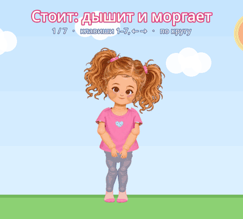

# Эмили на скелете (Godot 4.7)

2D-модель Эмили на скелете (Skeleton2D / Bone2D) с анимациями и демо-сценой.



## Демо в браузере (без Godot)

Папка `web/` — та же Эмили в виде веб-страницы: кадры выгружены из Godot
(`editor_tools/export_web_data.gd`) и рисуются теми же картинками.
Кнопки на экране, на компьютере — клавиши 1–7, ← →, пробел.

## Как запустить демо на компьютере

1. Скачайте проект: на GitHub нажмите зелёную кнопку **Code**, затем **Download ZIP**.
2. Распакуйте архив в `C:\Godot\`. Папку можно переименовать, например в `C:\Godot\EmilySkeleton`.
3. Запустите Godot 4.7.2 из `C:\Godot`. В окне **Project Manager** нажмите **Import**,
   выберите файл `project.godot` в этой папке и нажмите **Import & Edit**.
4. Первый раз Godot несколько секунд подготавливает картинки. Затем нажмите **F5**
   (или треугольник ▶ вверху справа), и откроется демо.

Проверка на ошибки через console-версию (в командной строке, из папки проекта):

```
C:\Godot\Godot_v4.7.2-stable_win64_console.exe --path . --quit-after 600
```

## Что внутри

| Путь | Что это |
|---|---|
| `scenes/demo.tscn` | демо-сцена (главная): фон, Эмили, подпись с названием анимации |
| `scenes/emily.tscn` | Эмили: скелет, картинки частей на костях, анимации (AnimationPlayer) |
| `scripts/emily.gd` | управление Эмили: `play_anim("wave")` и русские названия анимаций |
| `assets/emily/parts/` | нарезанные части (PNG с прозрачным фоном) |
| `assets/emily/reference/emily_idle.png` | оригинал (подложка для сверки) |
| `editor_tools/build_emily.gd` | сборщик скелета и анимаций |
| `tools/cut_parts.py` | нарезка листа частей на PNG |

Анимации: `idle` (стоит, дышит, моргает), `wave` (машет рукой), `walk` (идёт), `run` (бежит),
`jump` (прыгает), `crouch` (приседает), `hide` (закрывает глаза руками).

Скелет: Hips → Spine → Head; от Spine — руки (UpperArm → Forearm → Hand), от Hips — ноги
(Thigh → Shin → Foot). R — левая сторона экрана (правая рука Эмили), L — правая сторона экрана.

## Как пересобрать (для разработчика)

```
python3 -I tools/cut_parts.py tools/source/emily_parts_sheet_preview.jpg assets/emily/parts
python3 -I tools/find_anchors.py assets/emily/parts
godot --headless --path . --import
godot --headless --path . --script res://editor_tools/build_emily.gd
godot --headless --path . --script res://editor_tools/export_web_data.gd -- web/emily_data.json
```

В демо Godot: клавиши 1–7 — анимации, ← → — предыдущая/следующая, пробел — «по кругу».

Источники: лист частей Scenario `asset_L9Q4SbQsqU4CPs7YpDrSYPLy` (превью 1024×576),
оригинал `sprites/emily_idle.png` из артефакта «Герои игры Эмили».
